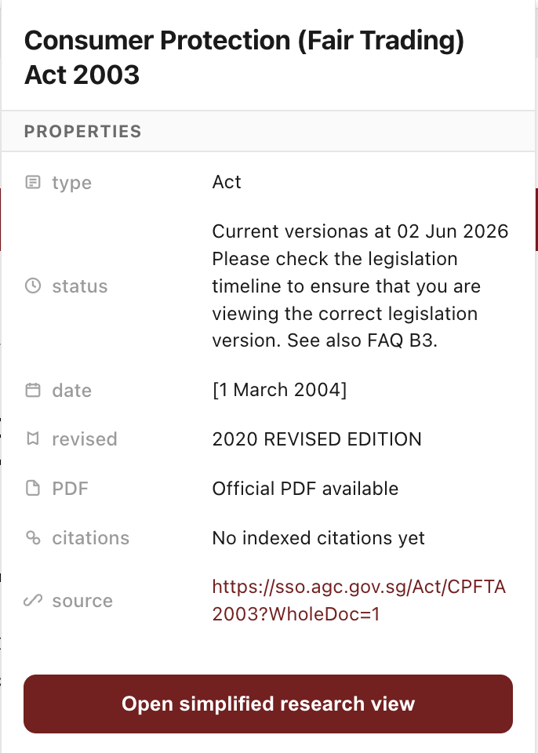
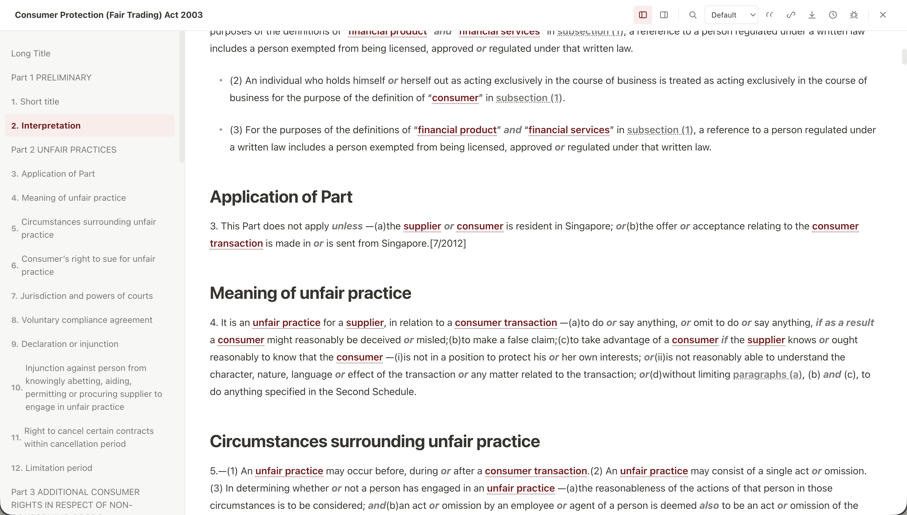
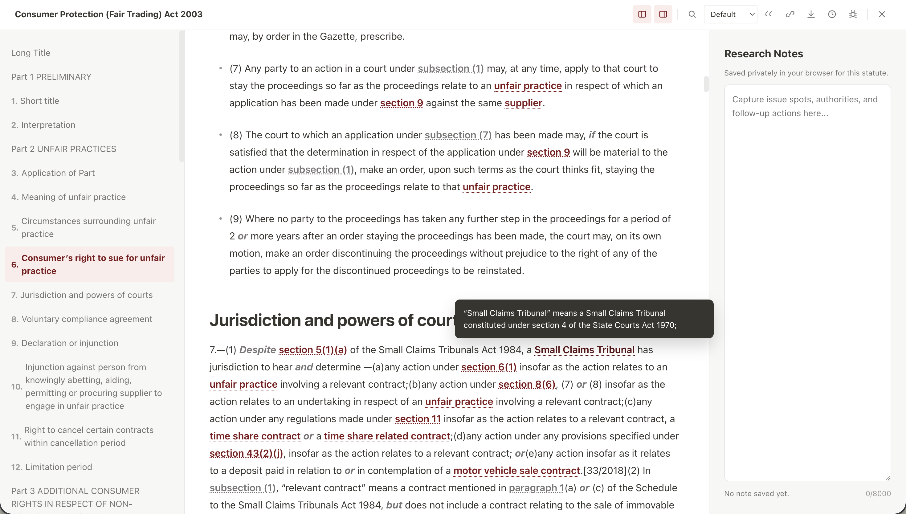
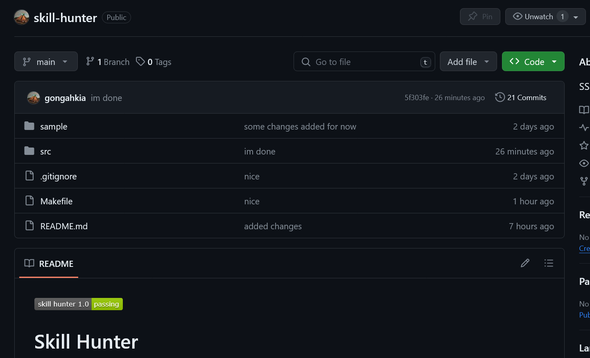
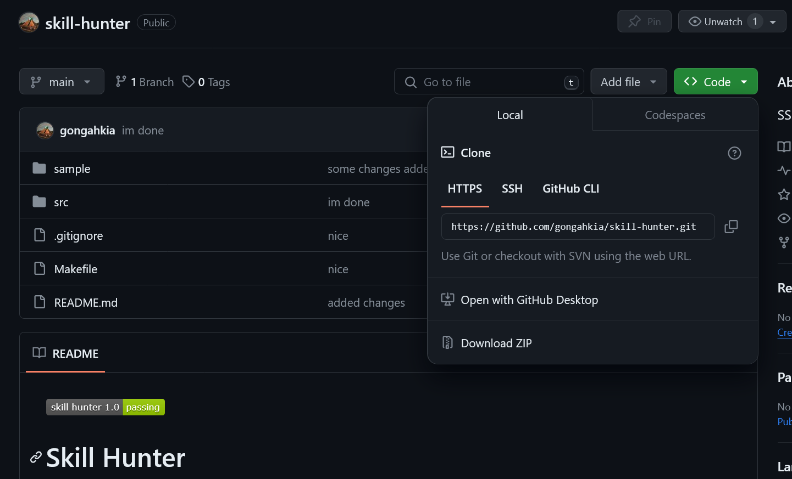
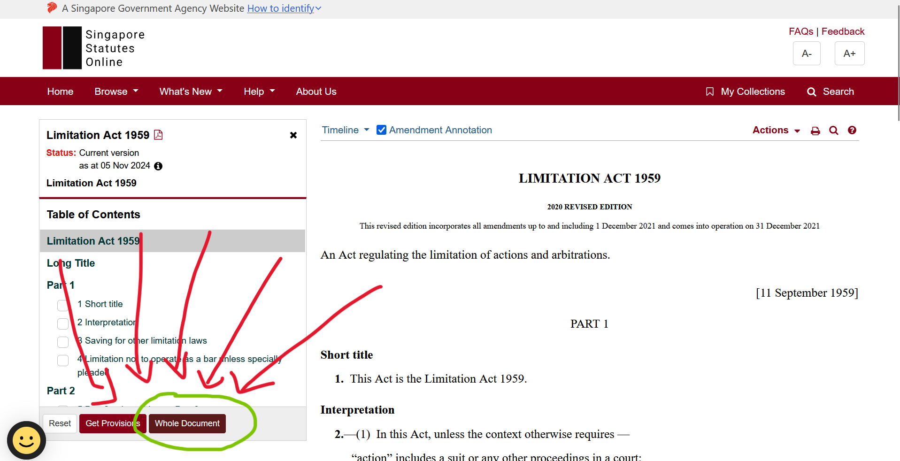

[](https://github.com/gongahkia/skill-hunter/releases/tag/3.0)


# `Skill Hunter`

<p align="center">
    
</p>

Browser extension that previews legal references on Singapore Statutes Online and eLitigation.

## Motivation

[SSO](https://sso.agc.gov.sg/) is a source for lawyers when keeping up to date with Singapore Legislation.

Time is often spent poring over definitions and navigating between interpretation and offence sections.

`Skill Hunter` previews definitions, statutory provisions and cited judgments in place.

## Purpose

* Statutory provisions and cited judgments are previewed in place
* Important terms are defined in place
* Original page text and controls are retained

## Screenshot

Screenshots from the earlier simplified reading view.





## Supported browsers

Build the current `Skill Hunter` locally. Find earlier versions on [Firefox browser Add-ons](https://addons.mozilla.org/en-US/firefox/).

| Browser | Status | Link |
| :--- | :--- | :--- |
| Firefox |  | [Installation](#installation) |
| Google Chrome |  | [Installation](#installation) |
| Safari |  | [Build and testing](./safari/TESTING.md) |

## Versions

* The current source is `Skill Hunter v2.0.0`, with inline legal reference previews.
* Earlier Firefox Add-ons are available as [Skill Hunter](https://addons.mozilla.org/en-US/firefox/addon/skill-hunter/) and [Skill Hunter 2](https://addons.mozilla.org/en-US/firefox/addon/skill-hunter-2/), with the older simplify workflow.

## [Presentation](./asset/presentation/class_part.pdf)

## Installation

Build `Skill Hunter` locally with Node.js 22+, npm and Make.

### CLI

```console
$ git clone https://github.com/gongahkia/skill-hunter
$ cd skill-hunter
$ npm ci
$ make build
```

### GUI

1. Click *Code*.



2. Click *Download ZIP*.



3. Unzip the ZIP file.

4. Open a terminal in the unzipped folder, then run `npm ci` and `make build`.

## Usage

Inline previews start disabled. The setting is saved across supported tabs.

### Chrome

1. Copy and paste this link in the search bar *chrome://extensions/*.
2. Toggle *Developer mode* on.
3. Click *load unpacked*.
4. Open the `skill-hunter` repo, select the built `dist` folder.
5. Open an **SSO** legislation page, then click *Whole Document*, or open an **eLitigation** judgment.



6. Click the extension icon, then click *Enable inline previews* and hover an underlined reference.

### Firefox

1. Copy and paste this link in the search bar *about:debugging#/runtime/this-firefox*.
2. Click *load temporary add-on*.
3. Open the `skill-hunter` repo, select `dist/manifest.json`.
4. Open an **SSO** legislation page, then click *Whole Document*, or open an **eLitigation** judgment.


5. Click the extension icon, then click *Enable inline previews* and hover an underlined reference.

## Browser support

Requires Chrome 121+ or Firefox 140+ (Firefox for Android 142+). Safari development builds require macOS 13.3+.

Support for browsers like Opera and Vivaldi has not been extensively tested. [Open an issue](https://github.com/gongahkia/skill-hunter/issues) for further support.

## References

The name `Skill Hunter` is in reference to the Nen ability of [Chrollo Lucilfer](https://hunterxhunter.fandom.com/wiki/Chrollo_Lucilfer) (クロロ＝ルシルフル), the founder and leader of the Phantom Troupe in the ongoing manga series, [HunterXhunter](https://hunterxhunter.fandom.com/wiki/Hunterpedia).


